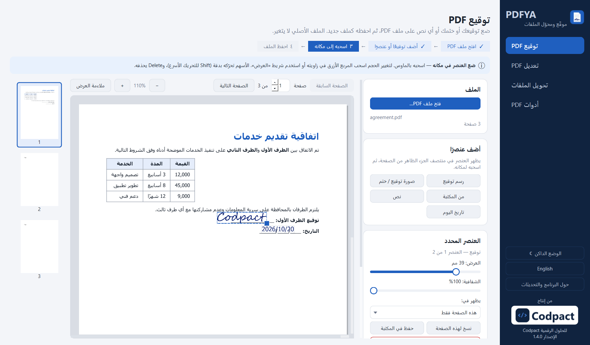
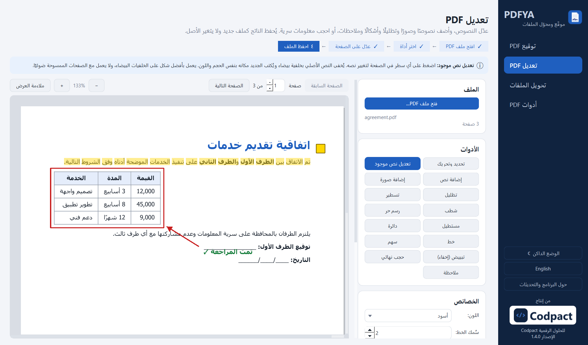
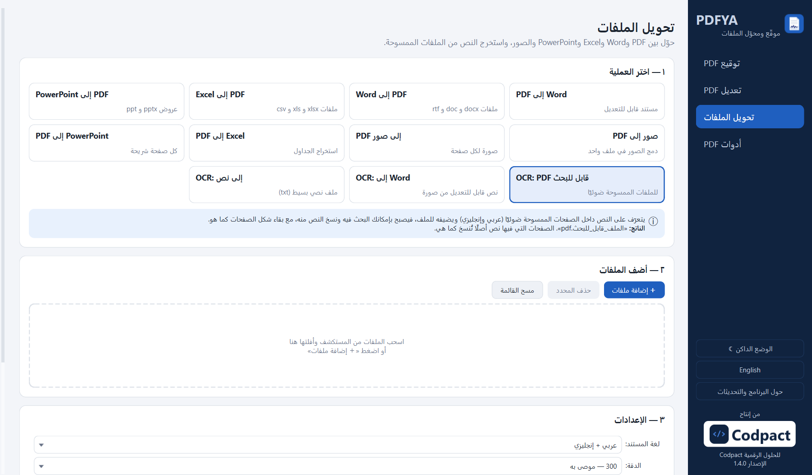
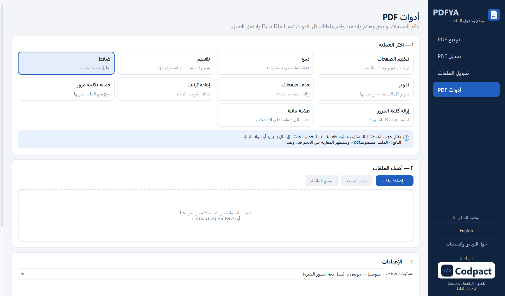

<div dir="rtl">

<div align="center">


# PDFYA — موقّع ومحوّل الملفات

**برنامج ويندوز مجاني يعمل بدون إنترنت لتوقيع ملفات PDF وتعديلها وتحويلها وتنظيمها، بدعم كامل للغة العربية.**

[English](README.md) · [التنزيل](../../releases/latest) · [سجل التغييرات](CHANGELOG.md)

من إنتاج **Codpact للحلول الرقمية**

</div>

---

<p align="center"></p>

## لماذا PDFYA؟

- **ملفاتك لا تغادر جهازك.** بدون رفع، وبدون حسابات أو اشتراكات.
- **عربي بشكل صحيح.** تشكيل الحروف والاتجاه من اليمين لليسار في الواجهة، وفي النصوص التي تضيفها للملفات، وفي التعرف على النص، وفي ملفات Word وExcel الناتجة.
- **إرشاد واضح.** كل شاشة تشرح ماذا تفعل، واسم الملف الناتج، وما تحتاجه.

## المميزات

### ✍️ توقيع PDF
- رسم التوقيع (ألوان، سُمك القلم، تراجع) أو استخدام صورة له مع إزالة الخلفية البيضاء تلقائيًا.
- **مكتبة** محفوظة للتواقيع والأحرف الأولى والأختام.
- عدة عناصر في نفس الملف: توقيع، ختم، نص حر (عربي/إنجليزي)، تاريخ اليوم.
- تحريك بالسحب، تغيير الحجم من الزاوية، الشفافية، واختيار ظهور العنصر في صفحة معينة أو الأولى أو الأخيرة أو كل الصفحات.
- **توقيع جماعي** لعدة ملفات بنفس العناصر.

### 📝 تعديل PDF
- **تعديل نص موجود**: اضغط على السطر وغيّر نصه مع الحفاظ على حجمه ولونه.
- إضافة نص (Tahoma وArial وTimes New Roman وCourier New) وصور.
- تظليل الكلمات وتسطيرها وشطبها.
- رسم حر، ومستطيلات ودوائر وخطوط وأسهم.
- **تبييض** لإخفاء جزء، أو **حجب نهائي** لحذف المعلومات السرية فعليًا من الملف.
- ملاحظات (تعليقات)، وتراجع، وتحريك أي تعديل قبل الحفظ.

### 🔄 التحويل
- PDF ⇄ Word · Word / Excel / PowerPoint إلى PDF · الصور ⇄ PDF
- PDF إلى Excel (استخراج الجداول) · PDF إلى PowerPoint
- **التعرف على النص OCR (عربي + إنجليزي)**: ملف ممسوح ← PDF قابل للبحث أو Word أو نص.

### 🧰 أدوات PDF
- منظّم صفحات مرئي (سحب لإعادة الترتيب، تدوير، حذف، تكرار).
- دمج، تقسيم، ضغط بثلاثة مستويات، تدوير، حذف وإعادة ترتيب الصفحات.
- حماية بكلمة مرور (AES-256) وإزالتها، وعلامة مائية.

### 🖥️ الواجهة
- العربية والإنجليزية (زر في الشريط الجانبي) · وضع فاتح وداكن.
- سحب الملفات وإفلاتها من المستكشف · نسبة تقدم حقيقية مع زر إلغاء.

<details>
<summary><b>صور أخرى</b></summary>

| تعديل PDF | التحويل |
|---|---|
|  |  |

| أدوات PDF | الوضع الداكن |
|---|---|
|  |  |

</details>

## التنزيل

نزّل أحدث إصدار من [صفحة الإصدارات](../../releases/latest):

- `PDFYA-Setup-x.y.z.exe` — ملف التثبيت (لا يحتاج صلاحيات مسؤول).
- `PDFYA-x.y.z-portable.zip` — فك الضغط وشغّل `PDFYA.exe` مباشرة.

إضافات اختيارية:
- **تحويل Word / Excel / PowerPoint إلى PDF** يحتاج Microsoft Office أو [LibreOffice](https://www.libreoffice.org/) المجاني.
- **التعرف على النص (OCR)** يحتاج برنامج [Tesseract](https://github.com/UB-Mannheim/tesseract/wiki) المجاني، مع اختيار اللغة العربية أثناء التثبيت.

> **ملاحظة:** التوقيع في PDFYA صورة توضع على الصفحة، وليس توقيعًا رقميًا معتمدًا بشهادة.

## التشغيل من الكود

يحتاج ويندوز وPython 3.10 أو أحدث (تم التطوير على Python 3.14).

</div>

```bash
git clone https://github.com/abdoo148/PDFYA.git
cd PDFYA
python -m venv .venv
.venv\Scripts\activate
pip install -r requirements.txt
python app.py
```

<div dir="rtl">

## بناء ملف EXE والمثبّت

شغّل `build.bat` بالضغط المزدوج، وسينتج:
- `dist\PDFYA\PDFYA.exe` — البرنامج.
- `dist\installer\PDFYA-x.y.z-portable.zip` — النسخة المحمولة.
- `dist\installer\PDFYA-Setup-x.y.z.exe` — المثبّت (يحتاج [Inno Setup 6](https://jrsoftware.org/isdl.php) على جهاز البناء).

لإصدار جديد غيّر `APP_VERSION` في `core.py` فقط.

## المساهمة

نرحب بالمقترحات وطلبات الدمج. كل نص يظهر للمستخدم يمر عبر الدالة `tr()` والنص العربي هو المفتاح، وتُضاف ترجمته الإنجليزية في `i18n_en.py`.

## الترخيص

PDFYA برنامج حر مرخّص بـ **GNU Affero General Public License v3.0** — راجع [LICENSE](LICENSE). يعتمد على PyMuPDF (AGPL-3.0)، وباقي المكتبات مذكورة في [THIRD_PARTY_NOTICES.txt](THIRD_PARTY_NOTICES.txt).

© 2026 Codpact للحلول الرقمية

</div>
