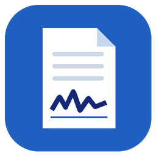
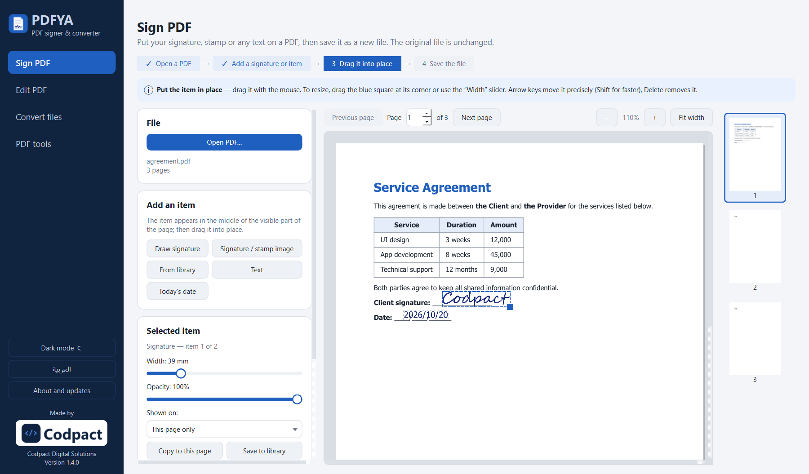
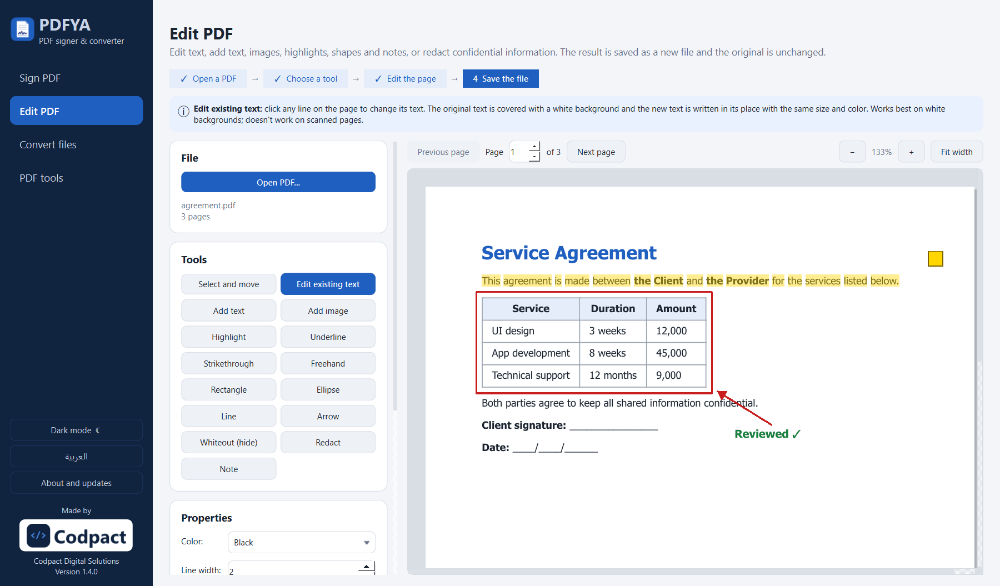
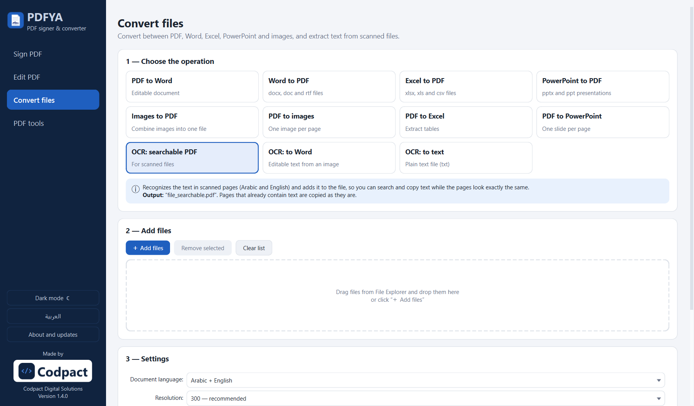
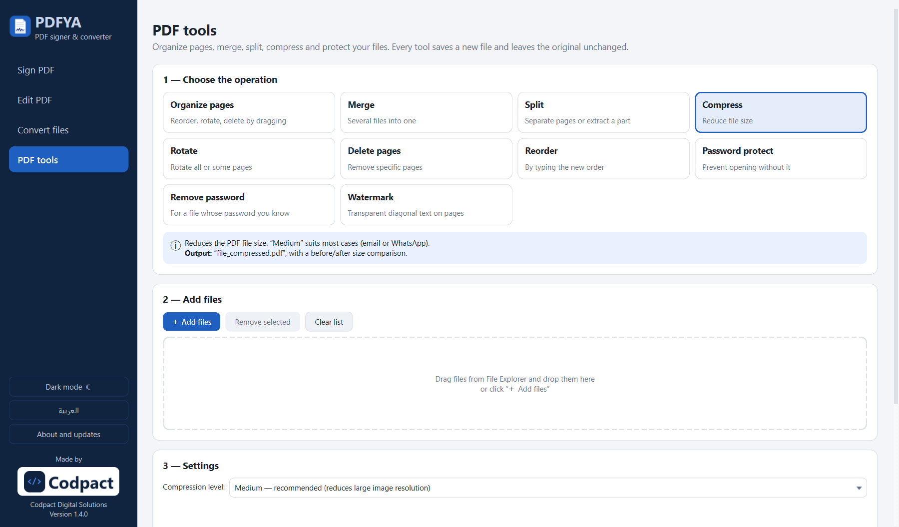
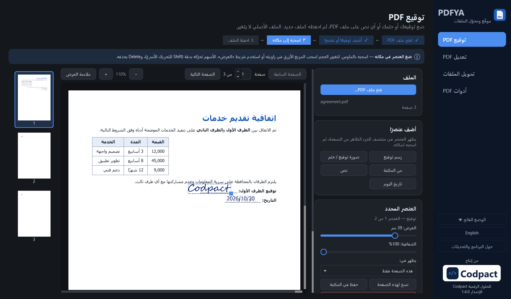

<div align="center">



# PDFYA

**A free, offline Windows app to sign, edit, convert and organize PDF files — with first-class Arabic support.**


[العربية](README.ar.md) · [Download](../../releases/latest) · [Changelog](CHANGELOG.md)

Made by **Codpact — Codpact Digital Solutions**

</div>

---

<p align="center"></p>

## Why PDFYA?

- **Everything stays on your computer.** No uploads, no accounts, no subscriptions.
- **Arabic done right.** Correct letter shaping and right-to-left layout everywhere — in the interface, in text you add to PDFs, in OCR and in exported Word/Excel files.
- **Guided, not cluttered.** Every screen tells you what it does, what file it will produce, and what it needs.

## Features

### ✍️ Sign PDF
- Draw your signature (colors, pen width, undo) or use an image of it — the white background is removed automatically.
- A saved **library** of signatures, initials and stamps.
- Place several items: signature, stamp, free text (Arabic/English), today's date.
- Drag to move, resize from the corner, set opacity, and choose where each item appears: this page, first, last or all pages.
- **Batch signing**: apply the same items to many files at once.

### 📝 Edit PDF
- **Edit existing text**: click a line, change it, keep its size and color.
- Add text (Tahoma, Arial, Times New Roman, Courier New) and images.
- Highlight, underline and strike through words.
- Freehand drawing, rectangles, ellipses, lines and arrows.
- **Whiteout** to hide content, or **Redact** to permanently remove confidential text and images.
- Sticky notes (comments), undo, and moving any edit before saving.

### 🔄 Convert
- PDF ⇄ Word · Word / Excel / PowerPoint → PDF · Images ⇄ PDF
- PDF → Excel (table extraction) · PDF → PowerPoint
- **OCR (Arabic + English)**: scanned file → searchable PDF, Word or plain text.

### 🧰 PDF tools
- Visual page organizer (drag to reorder, rotate, delete, duplicate).
- Merge, split, compress (3 levels), rotate, delete or reorder pages.
- Password protect (AES-256) / remove password, watermark.

### 🖥️ Interface
- Arabic and English UI (switch from the sidebar) · light and dark mode.
- Drag & drop files from File Explorer · real progress with cancel.

<details>
<summary><b>More screenshots</b></summary>

| Edit PDF | Convert |
|---|---|
|  |  |

| PDF tools | Arabic · dark mode |
|---|---|
|  |  |

</details>

## Download

Get the latest version from the [Releases page](../../releases/latest):

- `PDFYA-Setup-x.y.z.exe` — installer (no admin rights needed).
- `PDFYA-x.y.z-portable.zip` — unzip and run `PDFYA.exe`.

Optional extras:
- **Word / Excel / PowerPoint → PDF** needs Microsoft Office or the free [LibreOffice](https://www.libreoffice.org/).
- **OCR** needs the free [Tesseract](https://github.com/UB-Mannheim/tesseract/wiki) — select *Arabic* during installation.

> **Note:** signatures in PDFYA are images placed on the page, not certificate-based digital signatures.

## Run from source

Requires Windows and Python 3.10+ (developed with Python 3.14).

```bash
git clone https://github.com/abdoo148/PDFYA.git
cd PDFYA
python -m venv .venv
.venv\Scripts\activate
pip install -r requirements.txt
python app.py
```

## Build the EXE and installer

Double-click `build.bat`. It creates:

| Output | Description |
|---|---|
| `dist\PDFYA\PDFYA.exe` | The app (PyInstaller, one-folder build) |
| `dist\installer\PDFYA-x.y.z-portable.zip` | Portable version |
| `dist\installer\PDFYA-Setup-x.y.z.exe` | Installer — needs [Inno Setup 6](https://jrsoftware.org/isdl.php) on the build machine |

To release a new version, change only `APP_VERSION` in `core.py`.

## Project structure

```
app.py              entry point
core.py             all PDF logic (no UI): signing, editing, conversion, OCR, tools
i18n.py             translation helper — tr("Arabic text") returns the current language
i18n_en.py          English translations (Arabic source text is the key)
gui/
  main.py           main window, sidebar, language & theme switch
  sign_page.py      Sign PDF
  edit_page.py      Edit PDF
  convert_page.py   Convert files
  tools_page.py     PDF tools + page organizer
  operation.py      shared "choose → add files → settings → run" page template
  dialogs.py        draw signature, add text, library, about
  widgets.py        shared widgets (file list, progress bar, help boxes…)
  theme.py          light / dark styles
assets/             icon, splash screen, Codpact logo
build.bat · installer.iss · make_*.py · prune_build.py   build tooling
```

## Built with

[Python](https://www.python.org) · [PySide6 (Qt)](https://www.qt.io/qt-for-python) · [PyMuPDF](https://github.com/pymupdf/PyMuPDF) · [pdf2docx](https://github.com/ArtifexSoftware/pdf2docx) · [Pillow](https://python-pillow.org) · [openpyxl](https://openpyxl.readthedocs.io) · [python-pptx](https://github.com/scanny/python-pptx) · [python-docx](https://github.com/python-openxml/python-docx) · [Tesseract OCR](https://github.com/tesseract-ocr/tesseract) · [PyInstaller](https://pyinstaller.org) · [Inno Setup](https://jrsoftware.org/isinfo.php)

## Contributing

Issues and pull requests are welcome. Every user-visible string goes through `tr()` with the Arabic text as the key — add the English version to `i18n_en.py`.

## License

PDFYA is free software under the **GNU Affero General Public License v3.0** — see [LICENSE](LICENSE). It uses PyMuPDF (AGPL-3.0); other bundled libraries are listed in [THIRD_PARTY_NOTICES.txt](THIRD_PARTY_NOTICES.txt).

© 2026 Codpact — Codpact Digital Solutions
